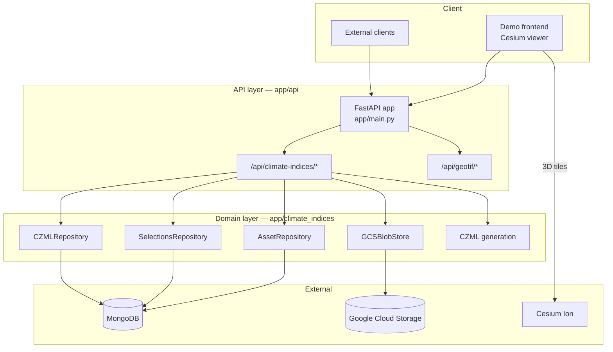
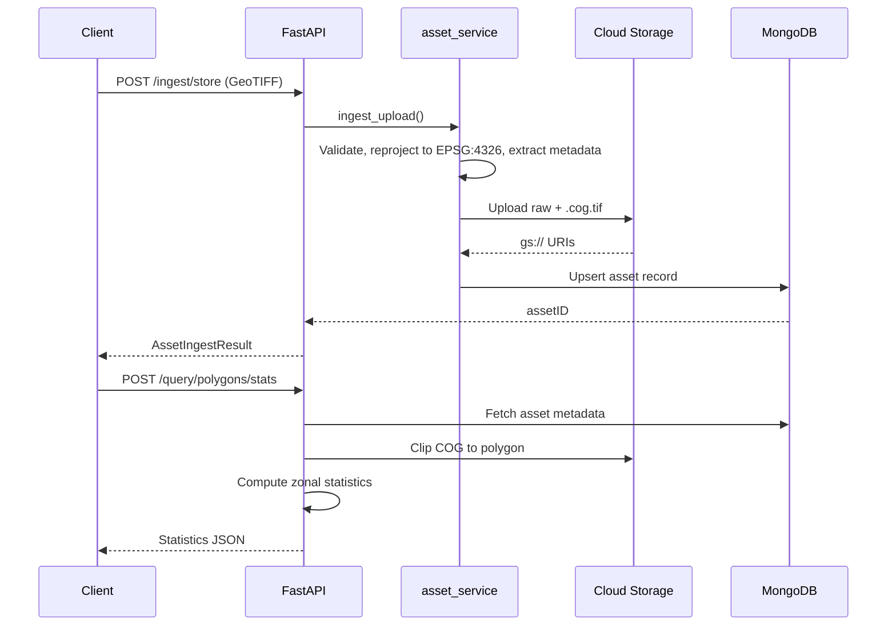

# Architecture

HOB FastAPI is a single FastAPI application with three layers, wired top-down in
`app/main.py` → `app/api/router.py`. It holds no state of its own: MongoDB stores metadata,
Google Cloud Storage stores rasters, and the service is free to be restarted or scaled
horizontally.

## System overview



## The three layers

**`app/api/` — HTTP.** `router.py` mounts everything under `/api`. The climate API lives at
`/api/climate-indices` and is assembled in `app/api/climate/endpoints/__init__.py`, which
composes one router module per concern: `ingest`, `tiles`, `assets`, `polygons`, `selections`,
`czml`, `config`. Keeping them separate is what stops the tile-rendering code and the CZML
export code from growing into each other.

`app/api/geotif/` is a **standalone** generic-GeoTIFF utility. It is not part of the climate
workflow and shares nothing with it but the raster helpers.

**`app/climate_indices/` — domain.** Services (`asset_service.py`), repositories
(`asset_repository.py`, `selections_repository.py`, `czml_repository.py`), storage
(`blob_storage.py`), Pydantic models (`models.py`), and CZML generation (`czml_generate.py`
orchestrating `czml_bar.py`, `czml_polygon.py`, `czml_circle.py`). The public surface is
re-exported from `__init__.py`, so callers import from the package rather than reaching into
modules.

**`app/geotif_converter/` — raster helpers.** Shared I/O and conversion (`raster_io.py` and
friends). Everything reprojects to EPSG:4326 on the way in, so no downstream code has to
consider projections.

`app/core/` holds logging, middleware and lifespan; `app/db/mongo.py` is the Mongo client;
`app/demo/` is a static CesiumJS frontend mounted at `/demo`.

## Code layout

```text
app/
├── main.py                       FastAPI entry point
├── api/
│   ├── router.py                 Root API router
│   ├── climate/
│   │   ├── query.py
│   │   └── endpoints/            ingest, tiles, assets, polygons,
│   │                             selections, czml, config
│   └── geotif/                   Standalone GeoTIFF utility
├── climate_indices/
│   ├── models.py                 Pydantic models
│   ├── asset_service.py          ingest_upload, persist_climate_index
│   ├── asset_repository.py       Asset MongoDB access
│   ├── selections_repository.py
│   ├── czml_repository.py
│   ├── blob_storage.py           GCSBlobStore
│   ├── czml_generate.py          Orchestrates the generators below
│   ├── czml_bar.py
│   ├── czml_polygon.py
│   ├── czml_circle.py
│   ├── czml_time.py
│   └── czml_description.py
├── geotif_converter/             Raster I/O, conversion, visualisation
├── commons/                      colours.py, file_io.py
├── core/                         logging, middleware, lifespan
├── db/mongo.py                   Motor + PyMongo client
└── demo/                         Static Cesium demo
```

| Component | Path |
|---|---|
| App entry | `app/main.py` |
| Climate routes | `app/api/climate/endpoints/*.py` |
| Domain models | `app/climate_indices/models.py` |
| Ingest service | `app/climate_indices/asset_service.py` |
| Asset repository | `app/climate_indices/asset_repository.py` |
| Selection repository | `app/climate_indices/selections_repository.py` |
| CZML repository | `app/climate_indices/czml_repository.py` |
| CZML generation | `app/climate_indices/czml_generate.py` |
| Blob storage | `app/climate_indices/blob_storage.py` |
| Raster I/O | `app/geotif_converter/raster_io.py` |
| MongoDB client | `app/db/mongo.py` |
| Colourmap utilities | `app/commons/colours.py` |

## Data flow



**Ingestion.** The endpoint checks content type and size, `ingest_upload()` extracts raster
metadata via `geotif_converter`, `GCSBlobStore` writes both objects and returns `gs://` URIs,
and the repository upserts the MongoDB record.

**Tiles.** An asset lookup yields the COG URI; `rio-tiler`'s `COGReader` reads it directly
from `gs://`; valid pixels are rescaled to 0–255 and a separate alpha mask is built; the
result is encoded as PNG.

**Polygon queries.** The COG is clipped with `rasterio.mask` and statistics are computed with
numpy. Results nest as `results[assetID][polygonIndex]`.

**CZML export.** A selection with its polygon statistics is fetched, the generators build
packets — cylinders whose height is the statistic times a multiplier for `bar`, extruded
shapes with temporal animation for `polygon` — and the document is upserted and returned.

## Design decisions

Conventions a reader will not find in the OpenAPI schema, and would otherwise reasonably
propose changing.

### Client-generated UUIDs are the upsert keys

`rasterID`, `selectionID` and `czmlID` are minted by the **client**, not the server, and they
drive server-side upserts. Re-uploading with the same `rasterID` replaces the record while
preserving its `_id` and `createdAt`; omitting the field always creates a new record.

This exists because the frontend has to reference an asset before the server has acknowledged
it — a user draws polygons against a raster that is still uploading — and because retrying a
failed upload must not produce duplicates. A server-assigned key would force a round trip
before any client-side reference could be formed, and would make retries unsafe.

The cost is that clients can collide IDs. That is accepted: UUID v4 collision is negligible,
and the alternative is worse.

MongoDB's own `_id` remains the internal primary key and still appears in URL paths as
`{id}`. Both identifiers are live, deliberately — see [Data model](schema.md#identifiers).

### Endpoints take form data, not JSON

`/ingest*` and `/query/polygons/*` accept `multipart/form-data`, not `application/json`,
because they carry file uploads alongside structured parameters. GeoJSON is passed as a
**stringified** form field rather than a nested object.

Clients must therefore use `FormData` and must not set a `Content-Type` header manually — the
browser sets the multipart boundary:

```javascript
const formData = new FormData();
formData.append('file', fileInput.files[0]);
formData.append('indexType', 'ppet');

await fetch('/api/climate-indices/ingest', {
  method: 'POST',
  body: formData
});
```

A `422 Unprocessable Entity` on these endpoints almost always means JSON was sent instead.

### Tile rescaling is done by hand

Tile rendering does not use `ImageData.rescale()` or `render(rescale=...)`. Both emit numpy
warnings on masked arrays. Valid pixels are rescaled to 0–255 `uint8` manually and a separate
`uint8` alpha mask is constructed. `ImageData` is immutable, so this builds new instances
rather than mutating masks.

### The `.cog.tif` is not yet a real COG

The object stored with the `.cog.tif` suffix is currently a **copy** of the raw GeoTIFF; no
`rio-cogeo` conversion is applied. Tile serving works because `rio-tiler` can read ordinary
GeoTIFFs, but without internal tiling and overviews it reads far more bytes per tile than it
needs to. Treat the suffix as a naming convention, not a guarantee.

## Technology stack

| Layer | Technology | Notes |
|---|---|---|
| Framework | FastAPI | Async, generates its own OpenAPI schema |
| Server | Uvicorn | ASGI |
| Validation | Pydantic v2 | camelCase aliases over the wire |
| Database | MongoDB | Motor (async) and PyMongo (sync) |
| Object storage | Google Cloud Storage | Raw GeoTIFF and `.cog.tif` |
| Raster I/O | rioxarray, rasterio, rio-tiler | Reads COGs directly from `gs://` |
| Geometry | Shapely | Polygon operations |
| CZML | czml3 | Cesium document generation |
| Colourmaps | Matplotlib | viridis, plasma and others |
| Packaging | uv | Lockfile-based installs |

## External dependencies

**Required.** MongoDB (Atlas or self-hosted) and a Google Cloud Storage bucket with
service-account credentials. The service will not start usefully without both.

**Optional.** Cesium Ion, for the 3D globe imagery in the demo frontend. The API itself does
not call it; the token is passed through to the browser by `/config`.

## Security posture

| Area | Status | Notes |
|---|---|---|
| Container user | Non-root | Runs as `appuser` |
| GCS credentials | Read-only mount | Never baked into the image |
| MongoDB transport | TLS | Uses `certifi` for Atlas connections |
| Upload validation | Content type and size limits | |
| CORS | **Open by default** | Allows all origins; restrict before exposing publicly |
| Authentication | **None** | There is no authN/authZ layer. Do not expose an instance to the internet without one in front of it |

The last two rows are deployment obligations, not defects to report — see
[Deployment](deployment.md).
