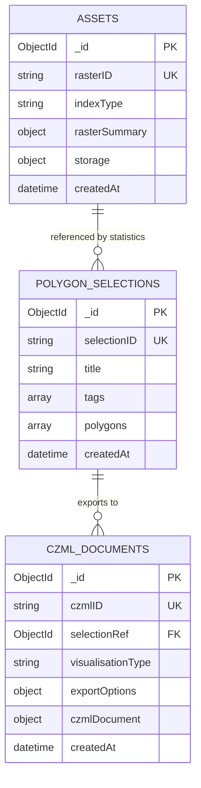

# Data model

Three MongoDB collections, and the shapes they exchange with clients.



## Field naming

The API speaks **camelCase**; the Python models are **snake_case**. Pydantic bridges the two
with field aliases, so `index_type` in `app/climate_indices/models.py` is `indexType` on the
wire and in MongoDB.

Read every example below as the wire format. When writing Python against these models, use
the snake_case names; when writing a client, use camelCase.

## Identifiers

Two ID systems run side by side, deliberately.

| ID | Format | Role |
|---|---|---|
| `_id` | 24-character hex ObjectId | MongoDB primary key. This is the `{id}` in URL paths |
| `rasterID` | UUID v4 | Client-generated key for an asset |
| `selectionID` | UUID v4 | Client-generated key for a selection |
| `czmlID` | UUID v4 | Client-generated key for a CZML document |

The UUIDs are minted by the client and drive upserts — see
[Architecture](architecture.md#client-generated-uuids-are-the-upsert-keys) for why. Each
entity also exposes a `/by-{type}-id/{uuid}` lookup endpoint for retrieval by UUID rather
than by `_id`.

**Upsert behaviour.** Supplying an existing UUID replaces that record while preserving its
`_id` and `createdAt`. Omitting the UUID always creates a new record.

## Ownership fields

Most entities accept two optional ownership fields. The service stores and filters on them
but does not interpret them — there is no user table and no access control. Managing user and
project records is the client's responsibility.

| Field | Purpose |
|---|---|
| `userID` | Owning user UUID |
| `projectID` | Project UUID, grouping assets, selections and CZML documents |

`GET /assets` accepts both as query parameters. Selections additionally carry `localeID` and
`siteID` for site-level grouping.

## Assets

Metadata for one ingested climate-index GeoTIFF.

```json
{
  "_id": "6632a1f4e8b3c9d1a0f5e2b7",
  "rasterID": "550e8400-e29b-41d4-a716-446655440000",
  "indexType": "humid-heat-stress",
  "timeRange": {
    "start": "2024-01-01T00:00:00Z",
    "end": "2024-12-31T23:59:59Z"
  },
  "units": "degC",
  "filename": "humid-heat-stress-2024.tif",
  "userID": null,
  "projectID": null,
  "customGroup": null,
  "rasterSummary": {
    "epsg": 4326,
    "crsWKT": "GEOGCS[\"WGS 84\", ...]",
    "bounds": { "left": 115.0, "bottom": 4.0, "right": 119.0, "top": 7.0 },
    "resolution": [0.25, 0.25],
    "sizes": { "width": 1440, "height": 720 },
    "dtype": "float32",
    "nodata": -9999.0,
    "min": 15.2,
    "max": 42.8,
    "mean": 28.5,
    "std": 5.2
  },
  "storage": {
    "raw": {
      "kind": "gcs",
      "uri": "gs://bucket/uploads/raw/550e8400.tif",
      "checksum": "sha256:…",
      "sizeBytes": 12345678
    },
    "cog": {
      "kind": "gcs",
      "uri": "gs://bucket/uploads/cog/550e8400.cog.tif",
      "checksum": "sha256:…",
      "sizeBytes": 9876543
    }
  },
  "createdAt": "2024-01-15T10:30:00Z"
}
```

`rasterSummary` is a snapshot taken at ingest time, after reprojection, so `epsg` is always
`4326`. It exists so that listing assets and checking whether a polygon intersects a raster
need no object-storage reads.

`storage.kind` is one of `local`, `gridfs`, `s3`, `gcs` or `unknown`. Only `gcs` is exercised
today. Note that the `.cog.tif` object is currently a copy of the raw file rather than a true
Cloud-Optimised GeoTIFF.

## Polygon selections

A named group of polygons with the statistics computed for each.

```json
{
  "_id": "6632b0c1e8b3c9d1a0f5e2c4",
  "selectionID": "a1b2c3d4-e5f6-7890-abcd-ef1234567890",
  "title": "Borneo protected areas",
  "description": "Sampling polygons for the 2024 comparison",
  "tags": ["protected", "borneo", "2024"],
  "localeID": null,
  "siteID": null,
  "userID": null,
  "projectID": null,
  "polygons": [
    {
      "title": "Central area",
      "geometry": {
        "type": "Polygon",
        "coordinates": [[[116.0, 4.0], [117.0, 4.0], [117.0, 5.0], [116.0, 5.0], [116.0, 4.0]]]
      },
      "centroid": { "lon": 116.5, "lat": 4.5 },
      "statistics": [
        {
          "assetRef": "6632a1f4e8b3c9d1a0f5e2b7",
          "indexType": "humid-heat-stress",
          "units": "degC",
          "count": 1234,
          "min": 22.1,
          "max": 38.5,
          "mean": 30.2,
          "median": 29.8,
          "std": 3.1,
          "assetFilename": "humid-heat-stress-2024.tif",
          "timeRange": { "start": "2024-01-01T00:00:00Z", "end": "2024-12-31T23:59:59Z" }
        }
      ]
    }
  ],
  "createdAt": "2024-01-20T14:00:00Z",
  "updatedAt": "2024-01-20T14:00:00Z"
}
```

Statistics are **denormalised into the selection** rather than referenced. Each entry copies
`indexType`, `units`, `assetFilename` and `timeRange` from the asset at the time of the query.
A selection is a record of what was measured and when, so it must survive the asset being
replaced by a later upload — and CZML export needs the labels without a join.

`count` is the number of valid pixels within the polygon, so a `count` of `0` means the
polygon missed the raster or fell entirely on nodata. That is the first thing to check when a
query returns nothing.

`createdBy` may appear on older documents. It is deprecated; use `userID`.

## CZML documents

A generated Cesium document, cached against the selection that produced it.

```json
{
  "_id": "6632c3d2e8b3c9d1a0f5e2f1",
  "czmlID": "b2c3d4e5-f6a7-8901-bcde-f12345678901",
  "selectionRef": "6632b0c1e8b3c9d1a0f5e2c4",
  "indexType": "humid-heat-stress",
  "title": "Protected areas — heat stress bars",
  "description": null,
  "userID": null,
  "projectID": null,
  "exportOptions": {
    "visualisationType": "bar",
    "colourmapName": "viridis",
    "scaleMin": 20.0,
    "scaleMax": 40.0
  },
  "czmlDocument": [{ "id": "document", "version": "1.0" }],
  "packetCount": 1,
  "createdAt": "2024-01-21T09:15:00Z",
  "updatedAt": "2024-01-21T09:15:00Z"
}
```

`selectionRef` is the selection's `_id`, not its `selectionID`.

`exportOptions.visualisationType` is one of:

| Value | Renders as |
|---|---|
| `polygon` | Extruded coloured polygon |
| `polygon2d` | Flat coloured polygon |
| `circle2d` | Flat circle at the polygon centroid |
| `bar` | 3D cylinder at the centroid, height encoding the statistic |

`scaleMin` and `scaleMax` bound the colour ramp. Leave them `null` to compute the range from
the data — fine for a single export, but set them explicitly when comparing several exports,
or each will be scaled to its own range and the colours will not mean the same thing.

`exportOptions` carries further fields (opacity, outline, label and interpolation settings)
that vary by visualisation type. The authoritative list is `CZMLExportOptions` in the
generated schema at `/docs`.
